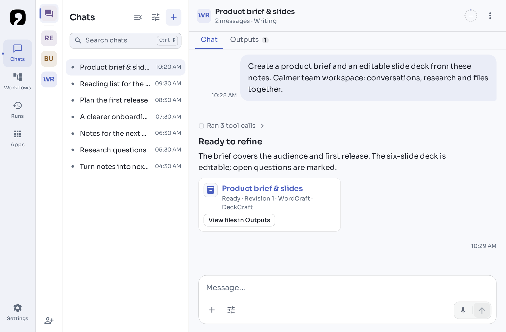
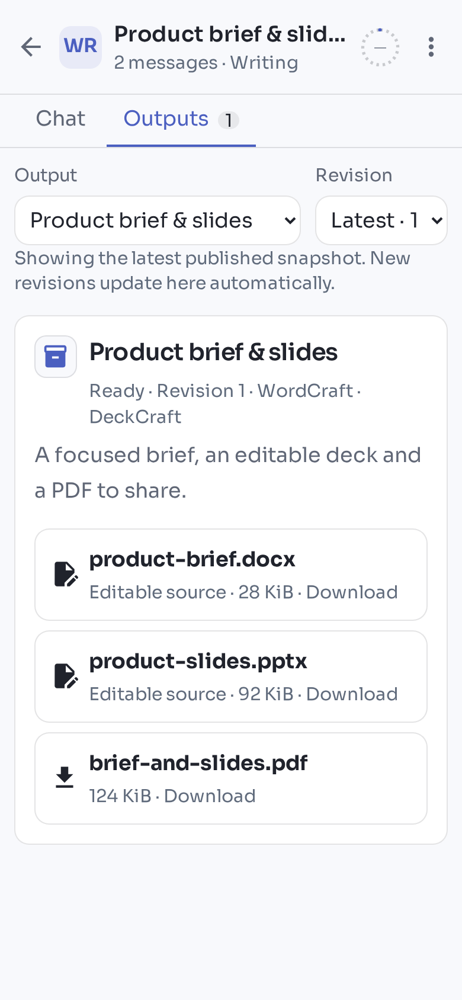

<p align="center">
  
</p>

<h1 align="center">Denkzeug</h1>

<p align="center"><strong>A tool for thought. Yours to shape.</strong><br />
Your agents, workflows and miniapps. A self-hosted home for the work that comes next.</p>

<p align="center">
  <a href="https://github.com/StromFLIX/nautionette/actions/workflows/ci.yml"></a>
  <a href="https://github.com/StromFLIX/nautionette/releases"></a>
  <a href="docs/self-hosting.md"></a>
</p>

<p align="center">
  <a href="https://nautionette.stromflix.com/">Website</a> ·
  <a href="https://nautionette.stromflix.com/#workspace">Screenshot tour</a> ·
  <a href="#run-it">Set up an instance</a> ·
  <a href="docs/README.md">Documentation</a> ·
  <a href="https://github.com/StromFLIX/nautionette/releases">Downloads</a>
</p>

Denkzeug connects conversations, useful files and repeatable work. Chat with agents
that use your tools, create things you can open and edit, then turn a useful process
into a durable workflow. Your agents run on your server; you connect from your
computer or phone.

<p align="center">
  <a href="services/website/assets/product-tour/chat.png"></a>
  <a href="services/website/assets/product/phone.png"></a>
</p>
<p align="center"><sub>Actual app screenshots with demo data. Click to enlarge, or <a href="https://nautionette.stromflix.com/#workspace">explore the screenshot tour</a>.</sub></p>

## Free. Remote. Extensible.

| Principle | What it means |
| --- | --- |
| **Free** | Self-host the whole app, without feature tiers. Model providers and infrastructure may still cost money. |
| **Remote** | Work happens on your server. Switch devices or close the client without stopping an accepted agent turn. |
| **Extensible** | Bring your models, MCP tools, agent instructions, skills and GitHub projects. Workflows are readable Python, not a proprietary diagram format. |

## Create. Process. Show.

### Create

Go from a conversation to software, a document, an editable presentation or a CAD
model. Agents use [Pi](https://pi.dev/) and native [ArtCraft applications](https://getartcraft.com/apps).
Published files, previews and editable sources stay with the chat in **Outputs**.

[Creative apps](docs/creative-apps.md) · [Durable outputs](docs/chat-outputs.md)

<a id="workflows-are-python-files"></a>

### Process

Turn work you want again into a workflow: give it inputs, a schedule or another
trigger, then inspect its runs, results and statistics. [Temporal](https://temporal.io/)
handles durable execution; workflow code remains plain Python you can read and edit.

[Workflow authoring and execution](docs/reference.md#workflows-are-python-files)

<a id="mini-apps"></a>

### Show

Put a small interface on top. Agents can publish miniapps with HTML, CSS and
JavaScript, plus an optional isolated Rust backend and SQLite. Buttons call the
app directly; ordinary interaction does not require another agent turn.

[Miniapp guide](docs/mini-apps.md)

## Run it

### 1. Get your copy

You need **Git**, **Docker Engine 28+** with **Docker Compose v2**, and an internet
connection for builds, tool downloads and your model provider. Node.js and Python
are not needed on the host for the Docker setup.

```sh
git clone https://github.com/StromFLIX/nautionette.git
cd nautionette
cp .env.example .env
```

### 2. Set your secrets

Edit `.env` before starting. Generate a **different** strong value for each of:

| Variable | Purpose |
| --- | --- |
| `APP_TOKEN` | The access token you enter when connecting a client. |
| `INTERNAL_TOKEN` | Private communication between the stack’s services. |
| `POSTGRES_PASSWORD` | Temporal’s PostgreSQL database password. |
| `MAXIO_SECRET_KEY` | Private storage for output files. |

Run `openssl rand -hex 32` separately for each value. Keep `.env` private and never
commit it. Leave `MAXIO_ACCESS_KEY` at its supplied value unless you intentionally
change it. Provider credentials can be added in the app after startup.

### 3. Start the stack

```sh
docker compose config --quiet
docker compose up -d --build
docker compose ps
```

Open **[the app at localhost:8080](http://localhost:8080)** and enter `APP_TOKEN`.
The landing page is at [localhost:8081](http://localhost:8081). Both ports bind to
loopback by default.

The first start builds or acquires agent images and prepares tools. The app can
open before agents are ready; check **Settings > System** or follow startup with
`docker compose logs -f docker-broker`.

### 4. Connect a model

Open **Settings > Agents & models > Model integrations**. Add a provider and test
it, or sign in with a GitHub account that has Copilot access. Then choose a model
and start a chat. Provider subscriptions, API access and usage charges are separate
from Denkzeug.

[Full setup, HTTPS, updates and backups](docs/self-hosting.md) ·
[Configuration template](.env.example)

> **Before making it public:** use HTTPS and a stable `APP_URL`, keep service ports
> private, and treat agent tools as trusted automation. This is actively developed
> self-hosted software, not a hardened multi-tenant service. See the
> [security and storage notes](docs/self-hosting.md#security-and-data).

## Use it from your devices

Every client connects to an **existing server** with its URL and access token;
installing a desktop or phone client does not install the backend.

| Client | Availability |
| --- | --- |
| **Web** | Open your instance in a browser. |
| **Desktop** | macOS Apple silicon/Intel, Windows x64 and Linux x64 installers in [Releases](https://github.com/StromFLIX/nautionette/releases). Desktop installers are currently unsigned. |
| **Android** | Sideload the release APK from [Releases](https://github.com/StromFLIX/nautionette/releases). |
| **iOS** | Source builds and unsigned CI archives; installation requires your own Apple signing/provisioning. Not a public installable IPA. |

[Client builds, signing and platform notes](docs/reference.md#desktop-and-ios-builds)

## Learn more

| Topic | Guide |
| --- | --- |
| Setup and operations | [Self-hosting](docs/self-hosting.md) |
| Agents, models and delegation | [Agent configuration](docs/agent-configuration.md) |
| Tools and connections | [MCP servers](docs/mcp-servers.md) |
| Creative work and files | [Native creative apps](docs/creative-apps.md) · [Outputs](docs/chat-outputs.md) |
| Miniapps | [Publishing and runtime guide](docs/mini-apps.md) |
| GitHub projects | [Project setup and worktrees](docs/reference.md#github-projects) · [Issue mentions](docs/github-mentions.md) |
| Architecture, APIs and development | [Technical reference](docs/reference.md) |

[Browse all documentation](docs/README.md)

## Contributing

Bug reports, reproducible examples and focused pull requests are welcome. Use
[Issues](https://github.com/StromFLIX/nautionette/issues) for bugs and proposals.
For a change, explain what it does and how you tested it; preserve existing user
data, technical identities and compatibility paths.

[Development and tests](docs/reference.md#python-development-and-integration-tests) ·
[Frontend design](docs/frontend-design.md) · [Brand assets](branding/README.md)

---

**Naming:** Denkzeug is the display name. Internal paths, environment variables,
package IDs and installer filenames retain `nautionette` for compatibility.
The [GitHub repository rename](docs/repository-rename.md) is a separate operation;
it must not rename storage or runtime identities.

**Licensing:** this repository does not yet include a project-wide `LICENSE` file.
Third-party code, fonts and other bundled assets retain their own licenses.
